<p align="center">
  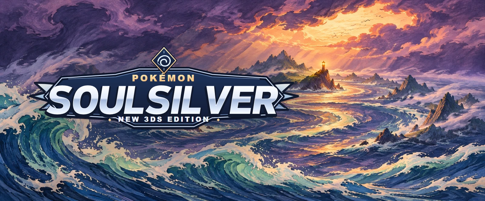
</p>

<h1 align="center">Pokémon HeartGold &amp; SoulSilver for New 3DS</h1>

<p align="center">
  Return to Johto in widescreen, with stereoscopic 3D, a near-60-fps overworld, and a touch-screen Pokégear.
</p>

<p align="center">
  <a href="#setup"></a>
  &nbsp;
  <a href="LICENSE"></a>
  &nbsp;
  <a href="#status"></a>
  &nbsp;
  <a href="#heartgold-experimental"></a>
  &nbsp;
  <a href="#see-it-in-play"></a>
</p>

<p align="center">
  <a href="https://github.com/unowncollectables/patch-builder/releases/latest"><strong>Download the Windows builder</strong></a>
  &nbsp;·&nbsp;
  <a href="#setup"><strong>Setup guide</strong></a>
  &nbsp;·&nbsp;
  <a href="#02--build-your-copy"><strong>Build instructions</strong></a>
  &nbsp;·&nbsp;
  <a href="https://github.com/unowncollectables/Pokemon-HeartGold-SoulSilver-New3ds/wiki"><strong>Complete wiki</strong></a>
</p>

<p align="center">
  
</p>

<p align="center">
  <sub>A fresh tour of current main: Johto towns, a Groudon battle, and the new battle toolkit. Explore the full gallery below.</sub>
</p>

## Contents

<table>
  <tr>
    <td width="33%"><a href="#features">Features</a></td>
    <td width="33%"><a href="#about">About</a></td>
    <td width="33%"><a href="#see-it-in-play">See it in play</a></td>
  </tr>
  <tr>
    <td><a href="#setup">Setup</a></td>
    <td><a href="#heartgold-experimental">HeartGold</a></td>
    <td><a href="#settings">Settings</a></td>
  </tr>
  <tr>
    <td><a href="#wireless--online">Wireless &amp; online</a></td>
    <td><a href="#status">Status</a></td>
    <td><a href="#for-developers">For developers</a></td>
  </tr>
</table>

[Credits](#credits) · [Legal](#legal)

---

## Features

<p align="center">
  
</p>

**A smoother, sharper Johto.** The overworld runs at about 60 fps in mono and close to it with stereoscopic 3D on New 3DS. The tuned speed setup is built in. Busy scenes, transitions, and battles can still dip. SoulSilver is the build played on hardware; HeartGold installs beside it as an experimental second game.

<table>
  <tr>
    <td align="center" width="20%" valign="top">
      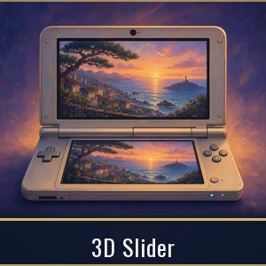<br>
      <sub><strong>3D slider.</strong> Stereoscopic depth in the field and in battles, on a console with a 3D slider.</sub>
    </td>
    <td align="center" width="20%" valign="top">
      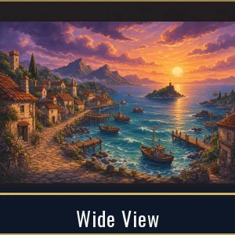<br>
      <sub><strong>Wide View.</strong> Towns, routes, and battles in widescreen.</sub>
    </td>
    <td align="center" width="20%" valign="top">
      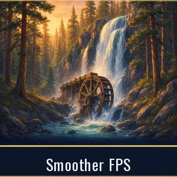<br>
      <sub><strong>Near-60-fps overworld.</strong> About 60 fps in mono and close to it in stereo 3D. The tested speed setup is the default.</sub>
    </td>
    <td align="center" width="20%" valign="top">
      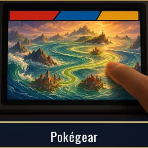<br>
      <sub><strong>Touch-screen Pokégear.</strong> A live map, party, and bag, plus phone and radio, without leaving the field.</sub>
    </td>
    <td align="center" width="20%" valign="top">
      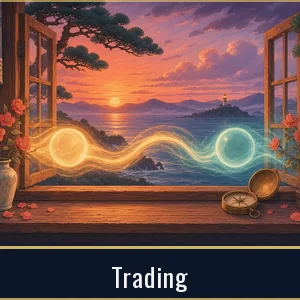<br>
      <sub><strong>Trading.</strong> Union Room trades between two consoles running the port. Confirmed on hardware.</sub>
    </td>
  </tr>
  <tr>
    <td align="center" valign="top">
      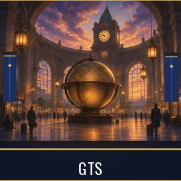<br>
      <sub><strong>GTS.</strong> Community-server Global Trade Station. The original path has worked on SoulSilver hardware.</sub>
    </td>
    <td align="center" valign="top">
      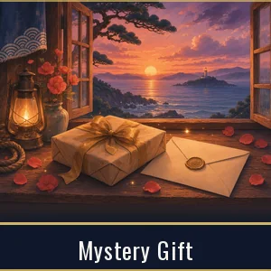<br>
      <sub><strong>Mystery Gift.</strong> Wonder Cards through Get via Nintendo WFC. The WFC path has worked on SoulSilver hardware.</sub>
    </td>
    <td align="center" valign="top">
      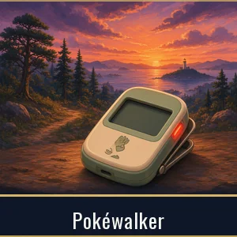<br>
      <sub><strong>Pokéwalker.</strong> Send and return over the New 3DS infrared port. Both have worked on a New 3DS.</sub>
    </td>
    <td align="center" valign="top">
      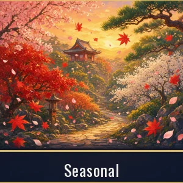<br>
      <sub><strong>Living Johto.</strong> Visible wild Pokémon, lively towns, and seasonal trees. Optional Ambient Weather adds petals, leaves, seeds, and flurries.</sub>
    </td>
    <td align="center" valign="top">
      <br>
      <sub><strong>HeartGold.</strong> The same port as its own install. Experimental, and not yet played on a console.</sub>
    </td>
  </tr>
</table>

- **Sharp text on both screens.** Dialogue, menus, battle messages, move names, and Pokémon names use native-resolution text. The Pokégear and Settings get their own sharp text layer. Both options start on.
- **Find your next catch.** Tap a species in a location’s wild list to see its true-colour icon, encounter pins, time-of-day filters, and a **LIST** of locations with encounter-slot chances. **AREAS** lists recognized sub-areas inside a place and tracks your visits separately from the save.
- **A battle companion.** Press <kbd>Y</kbd> in battle for a tabbed overlay with the available Pokémon info, catch odds, hunt stats, damage checks, or trainer party. Tap or swipe between pages while the battle keeps running. FIGHT also has move-effectiveness hints.
- **A livelier world.** Visible wild Pokémon can form groups, react to one another, step aside for NPCs, and scatter after a battle. There are ambient town Pokémon and visible encounters in the Safari Zone too.
- **Less menu-hopping.** Pan and fling the map, switch tabs more quickly, check party and bag, follow roamers and eggs, or use Tap to Fly and the Bug-Catching Contest helper.

Open Settings with <kbd>L</kbd> + <kbd>R</kbd> + <kbd>Y</kbd>. Recent additions and their remaining hardware checks are under [Status](#status).

## About

**Pokémon HeartGold & SoulSilver for New 3DS** is a fan-made, native New Nintendo 3DS port of Pokémon SoulSilver and Pokémon HeartGold (HGSS), built from the [pret/pokeheartgold](https://github.com/pret/pokeheartgold) decompilation. It is not a DS emulator and not a ROM hack: the game is compiled to run directly on the 3DS, and you install it as a `.cia` from the HOME Menu (or launch the `.3dsx` from the Homebrew Launcher) on a New 3DS, New 3DS XL, or New 2DS XL with custom firmware (Luma3DS).

It adds things the original DS game can't do: stereoscopic 3D with the 3D slider, a widescreen Wide View, a smoother frame rate, and a touch-screen Pokégear with a live map, party, and bag. Trading, the GTS, Mystery Gift, and the Pokéwalker (send and return over the 3DS infrared port) still work. Player options live in the in-game settings; the tested performance improvements are built in.

This repository holds source code, patches, tooling, and documentation. It contains no ROMs, extracted game-data bundles, saves, or prebuilt game packages. You build your own copy from a legally dumped HeartGold or SoulSilver ROM you own.

## See it in play

<p align="center">
  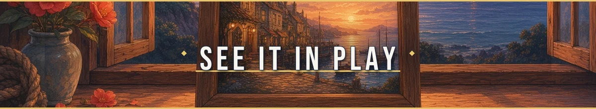
</p>

### A new view of Johto

A bright morning in Cianwood, with Feraligatr following. In battle, the new Y overlay keeps the information close without pausing the fight.

<table>
  <tr>
    <td align="center" width="50%" valign="top">
      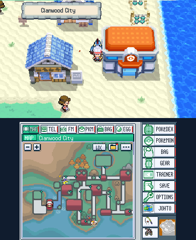<br>
      <sub>Cianwood: Wide View, your partner, and the Johto map on the touch screen.</sub>
    </td>
    <td align="center" width="50%" valign="top">
      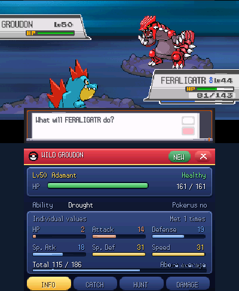<br>
      <sub>Press Y for battle info. Browse the available pages by tab or swipe; the battle keeps running.</sub>
    </td>
  </tr>
</table>

### The touch screen earns its place

Close-ups of the actual touch screen:

<table>
  <tr>
    <td align="center" width="50%" valign="top">
      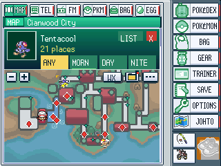<br>
      <sub>Tap a species to pin its encounter locations and filter by time of day.</sub>
    </td>
    <td align="center" width="50%" valign="top">
      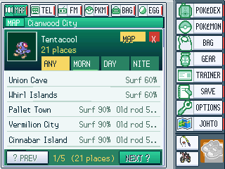<br>
      <sub>LIST shows where to catch it, with encounter-slot chances and paged locations.</sub>
    </td>
  </tr>
</table>
<table>
  <tr>
    <td align="center" width="50%" valign="top">
      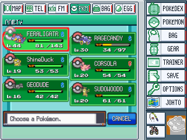<br>
      <sub>Your actual party in the touch-screen panel.</sub>
    </td>
    <td align="center" width="50%" valign="top">
      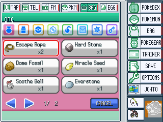<br>
      <sub>Browse bag pockets and items without leaving the field.</sub>
    </td>
  </tr>
</table>

<table>
  <tr>
    <td align="center" width="50%" valign="top">
      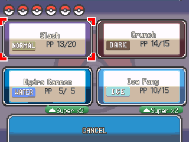<br>
      <sub>Sharper battle text and move-effectiveness hints.</sub>
    </td>
    <td align="center" width="50%" valign="top">
      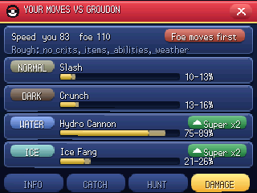<br>
      <sub>Check speed and rough move damage from the same battle overlay.</sub>
    </td>
  </tr>
</table>

<details>
<summary><strong>Take the scenic route · more from the new build</strong></summary>

<table>
  <tr>
    <td align="center" width="50%" valign="top">
      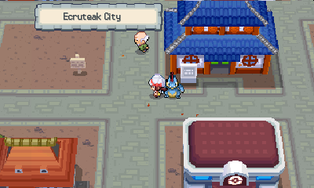<br>
      <sub>Ecruteak: your follower and the town’s ambient Pokémon.</sub>
    </td>
    <td align="center" width="50%" valign="top">
      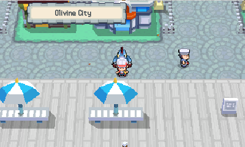<br>
      <sub>Olivine: the seaside streets in Wide View.</sub>
    </td>
  </tr>
</table>
<table>
  <tr>
    <td align="center" width="50%" valign="top">
      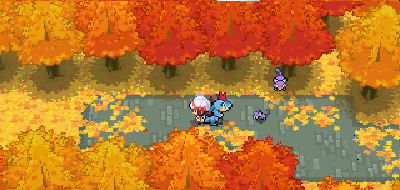<br>
      <sub>Bellchime Trail’s autumn canopy, falling leaves, and Feraligatr.</sub>
    </td>
    <td align="center" width="50%" valign="top">
      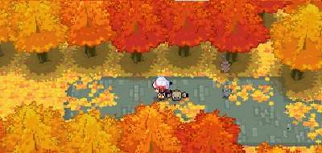<br>
      <sub>Switch partners and take Geodude through the autumn canopy.</sub>
    </td>
  </tr>
</table>

</details>

<sub>Fresh SoulSilver captures from main <a href="https://github.com/unowncollectables/Pokemon-HeartGold-SoulSilver-New3ds/commit/5e39a63d3412facf1c5df21f038a696e80e161a0">5e39a63</a>, 19 November 2026, using <a href="https://github.com/estyseesghosts/lotus">Jules’s LOTUS/CITnLO</a> and <a href="https://github.com/estyseesghosts/SAV4HGSS-cli">SAV4HGSS-cli</a>. A fixed morning clock, optional Ambient Weather, camera settings and copied-save warps were used for the tour; achievement popups and the FPS counter were disabled. The Groudon scene uses a staged postgame save. Images show mono output; stereo depth and hardware frame rate cannot be demonstrated by these screenshots. <a href="assets/screens/README.md">Capture notes</a>.</sub>

- **Top screen.** Walk through towns and routes in widescreen, with optional stereoscopic depth in the field and in battles on consoles with a 3D slider.
- **Touch screen.** Check your party, bag, map, phone, or radio without leaving the field. Optional tools surface encounter locations, Fly destinations, egg progress, a seasonal forecast, and Bug-Catching Contest stats.
- **Your save.** Bring over a standard 512 KiB cartridge or flashcart save by copying it onto the save file. The port keeps one backup (`soulsilver.sav.bak1`) and can export a copy from Settings. Shiny hunt stats live in `hunt.txt`, and a StarMe profile lives in its own files.
- **Your pace.** Customize battle speed, text speed, move effectiveness hints, and visible wild encounters. With Ambient Weather on, clear outdoor maps can show the current season. Seasonal trees are a separate option.

<p align="center">
  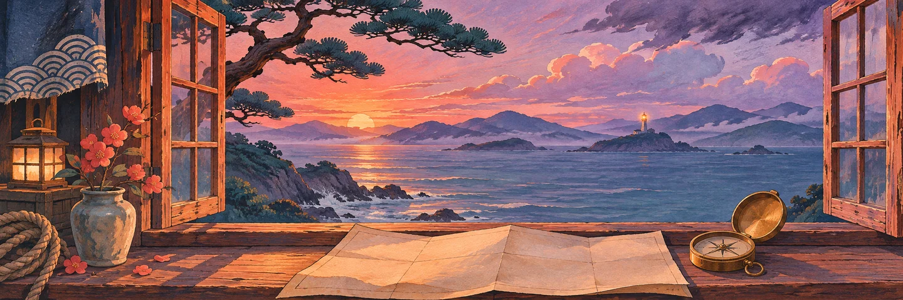
</p>

<a id="getting-started"></a>

## Setup

<p align="center">
  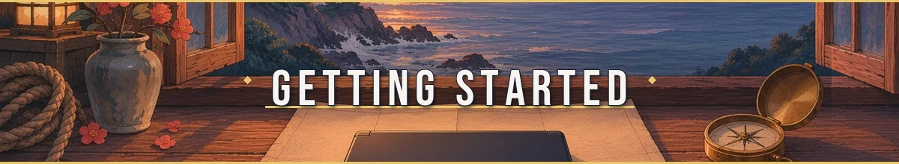
</p>

Build from your own US cartridge dump. The repository has no ROM in it. If you already play this port, copy your save off the SD card before replacing the build.

### 1. Check your kit

| You need | |
| --- | --- |
| Console | New Nintendo 3DS, New 3DS XL, or New 2DS XL with custom firmware. See the [3DS Hacks Guide](https://3ds.hacks.guide/). |
| Game | Your own dump of Pokémon SoulSilver (USA). HeartGold uses its own dump. See [HeartGold](#heartgold-experimental). |
| SD card | The card you use with the console. |

<a id="02--build-your-copy"></a>

### 2. Build your copy

On **Windows 10/11**, open [Pokémon 3DS Builder](https://github.com/unowncollectables/patch-builder) and choose your US `.nds` dump. SoulSilver and HeartGold can be built in the same run. The builder sets up the toolchain and can copy the finished build to the SD card. A `.cia` lands in the card's `cias` folder.

<details>
<summary><strong>Build SoulSilver by hand on Linux or WSL</strong></summary>

Install devkitPro's `3ds-dev` toolchain, Python 3 with `ndspy`, Git, make, patch, rsync, and curl. Keep the ROM outside the clone.

```sh
bash scripts/bootstrap.sh
bash scripts/ss3ds_build.sh ~/roms/SoulSilver.nds
cd soulsilver3ds/full && make check && make
make cia  # Optional HOME Menu package
```

See the [build guide](docs/BUILDING.md) and [toolchain setup](docs/SETUP.md). HeartGold has its own commands under [HeartGold](#heartgold-experimental).

</details>

### 3. Launch on the console

Put your dump at `sdmc:/3ds/soulsilver3ds/soulsilver.nds`.

| Launch | Where the program goes |
| --- | --- |
| Homebrew Launcher | Copy `soulsilver3ds.3dsx` into `sdmc:/3ds/`. |
| HOME Menu | Copy `soulsilver3ds.cia` to `sdmc:/cias/` and install it with FBI. |

In [New3DS FBI](https://github.com/unowncollectables/New3DS-FBI), **Update my Pokemon ports** (the progress screen is titled "Update my ports") lists that file and, after you confirm, installs title `000400000F7D4000`.

When bringing over an existing save, use a copy and keep the original off the SD card.

<details>
<summary><strong>Save files and SD card layout</strong></summary>

SoulSilver uses these files in `sdmc:/3ds/soulsilver3ds/`. HeartGold uses the same names under `sdmc:/3ds/heartgold3ds/`, with `heartgold.nds` and `heartgold.sav`.

| File | Role |
| --- | --- |
| `soulsilver.nds` | Your US cartridge dump. The game only reads it. |
| `soulsilver.sav` | The 512 KiB save. The game creates it on first launch if needed. |
| `soulsilver.sav.bak1` | The one backup of the save (made after each in-game save and at exit). |
| `config.txt` | Settings. Delete a line to return that key to its built-in default. |
| `hunt.txt` | Hunt stats. Separate from the save. |
| `starme-wfc-*.bin` | StarMe WFC profile for one trainer, when that server is selected. Separate from the save. |
| `log.txt` | The current run log. `log_crash.txt` keeps a log from an unclean exit. |

To bring in a cart, flashcart, or emulator save, copy it over `soulsilver.sav` (keep a copy of the old one first). There is no import step.

</details>

## HeartGold (experimental)

<p align="center">
  
</p>

HeartGold is the same port, built as its own game from your own US HeartGold dump. It installs beside SoulSilver. SoulSilver's folder, save, and HOME Menu title stay as they are.

The first full HeartGold build compiled, linked, and packaged, including the Ho-Oh banner. A console playtest and an emulator playtest are both still ahead. Every SoulSilver hardware result on this page still needs its own HeartGold check, online included.

| | SoulSilver | HeartGold |
| --- | --- | --- |
| SD folder | `sdmc:/3ds/soulsilver3ds/` | `sdmc:/3ds/heartgold3ds/` |
| ROM and save | `soulsilver.nds`, `soulsilver.sav` | `heartgold.nds`, `heartgold.sav` |
| Programs | `soulsilver3ds.3dsx`, `soulsilver3ds.cia` | `heartgold3ds.3dsx`, `heartgold3ds.cia` |
| HOME Menu title | `000400000F7D4000` | `000400000F7D4100` (`CTR-H-HG3D`) |
| HOME Menu banner | Lugia, taken from your SoulSilver ROM at build time | Ho-Oh, taken from your HeartGold ROM at build time |
| Settings | `config.txt` in the SoulSilver folder | Its own `config.txt`. The menu and the missing-key defaults are the same. |

A line in one `config.txt` stays in that game. Hunt stats go to that game's `hunt.txt`.

<details>
<summary><strong>Build and install HeartGold</strong></summary>

`scripts/hg_build.sh` compiles HeartGold in `pspoke-hg/`, and `scripts/hg_rename.py` gives that build HeartGold names.

On Windows, choose your US HeartGold dump in [Pokémon 3DS Builder](https://github.com/unowncollectables/patch-builder). The builder treats HeartGold as experimental and gives it its own output folder.

By hand, from this repository:

```sh
bash scripts/hg_build.sh /path/to/HeartGold.nds   # compiles the game (long the first time)
make -C heartgold3ds/full                         # heartgold3ds.3dsx
make -C heartgold3ds/full cia                     # heartgold3ds.cia, Ho-Oh on the banner
```

The ROM is only read. Nothing from it is stored in this repository. If the Ho-Oh banner check fails, the package falls back to the flat banner. The link stops if a HeartGold program still names a SoulSilver file.

Install it beside SoulSilver:

1. Put your dump at `sdmc:/3ds/heartgold3ds/heartgold.nds`.
2. Homebrew: copy `heartgold3ds.3dsx` to `sdmc:/3ds/`.
3. HOME Menu: copy `heartgold3ds.cia` to `sdmc:/cias/`. In New3DS FBI, open **Update my Pokemon ports**. That screen looks in `sdmc:/cias/` (and `sdmc:/fbi/ports/`) for title `000400000F7D4100` and installs it beside SoulSilver after you confirm.

</details>

## Settings

<p align="center">
  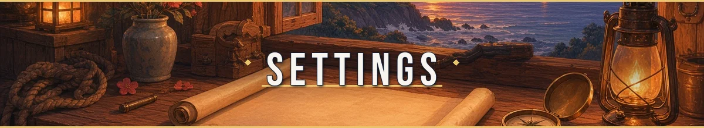
</p>

Open Settings with <kbd>L</kbd> + <kbd>R</kbd> + <kbd>Y</kbd>, or hold the top-left corner of the touch screen.

<p align="center">
  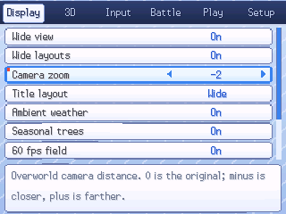<br>
  <sub>The capture session’s Display tab. Ambient Weather is enabled for this tour; new setups currently default it OFF.</sub>
</p>

| | |
| --- | --- |
| Browse | <kbd>L</kbd> and <kbd>R</kbd>, or tap a tab. |
| Change | <kbd>←</kbd> <kbd>→</kbd> or <kbd>A</kbd> |
| Apply and save | Close with <kbd>B</kbd>, <kbd>START</kbd>, or <kbd>L</kbd> + <kbd>R</kbd> + <kbd>Y</kbd>. Changes are written to `config.txt`. |

**Updating from an older build?** Saved settings take priority over new defaults. To start with the current tuned setup, close the game, keep a copy of `config.txt`, then remove it from the game’s folder and relaunch. This resets settings; keep your `.sav` in place. No performance tuning is needed on a fresh setup.

<details>
<summary><strong>Built-in defaults</strong></summary>

A missing `config.txt` line uses `kCfgDefaults` in `soulsilver3ds/platform/psp_ctru.c`. A line already in the file wins, including OFF. HeartGold reads that same table. The [settings reference](soulsilver3ds/full/README_settings.txt) lists keys; where it and the table disagree, the table is what the game reads.

| If this line is missing | It starts as |
| --- | --- |
| Title layout | WIDE |
| Command shortcut, Bounds shortcut, Affine object GPU, Second screen fades | ON |
| Second screen GPU | ON (`gpu_compose_b=1`; CHECK is 2) |
| Sharp 3D | FAST AUTO |
| Sharp text / Sharp game text | ON / ON |
| Fast tab swap | ON |
| Ambient weather | OFF (until it is fixed) |
| Seasonal trees | ON |
| Wide layouts | ON |
| 3D strength | 1X |
| Alive wild Pokémon | ON + TOWNS |
| Pokédex finder, Tap to Fly, Roamer sprites, Contest helper, Breeding tab, Reusable TMs, Event Pokémon without the event flag, Hunt stats, Damage check, Pokéwalker | ON |
| Map zoom | 1X (2X is the closer map; `-` / `+` on the map match it) |
| GTS server picker | ON |
| Wireless | ONLINE |
| FPS counter | ON |
| Log detail | SHORT (config only, `log_level=2` for FULL) |
| 60 fps field | ON, with the tested speed setup (3D worker thread and the rest of the old Render tab) |

The old Debug and Render tabs are gone from the menu: their keys use this same table (Speed tweaks starts at `fps_tweaks=7`), and a `config.txt` line still overrides them. Diagnostics are config-only under new names (`g3_gputime_dbg`, `fps60_area_dbg`) so an old line cannot leave them on.

</details>

## Wireless &amp; online

<p align="center">
  
</p>

| Path | In short |
| --- | --- |
| Local | Settings → Setup → Wireless → **LOCAL** on both consoles, then the Union Room. Trading between two consoles running the port is confirmed on hardware. |
| Online | With no `wireless` line, Wireless starts at **ONLINE**: community-server GTS, and Mystery Gift → Get via Nintendo WFC. Both paths have worked on SoulSilver hardware. |
| Pokéwalker | On by default. Send a Pokémon to a Pokéwalker from the PC and bring it back, over the New 3DS infrared port. Send and return have both worked on a New 3DS. Repeat runs and the latest menu fix still need more hardware checks. |

<details>
<summary><strong>Wireless, GTS, and Pokéwalker notes</strong></summary>

**Local.** Discovery can take a moment. A DS cartridge can't join this 3DS session. The other Union Room activities are still unverified.

**Online.** GTS and Mystery Gift use separate services, and availability depends on the community hosts. Online mode requires every `cheat_*` setting off. `wifi_dns` overrides the community DNS used by Poké Classic. See the [wireless guide](docs/WIRELESS.md).

**Server picker.** Turn on **GTS server picker** in Setup, then reopen the title menu. Online Settings offers Poké Classic (the DNS path above), StarMe, and Wi-Fi setup instructions. Turning the picker off uses the DNS path again, including after StarMe was selected. StarMe's WFC identity is a file in the port folder. Poké Classic keeps using the profile stored in the save. Leaving the GTS runs the WFC cleanup that exit used to skip. Live deposit, pickup, and a hardware re-entry are still open.

**Pokéwalker.** On by default. Send a Pokémon to a Pokéwalker from the PC and bring it back, over the New 3DS infrared port. Send and return have both worked on a New 3DS. Repeat runs and the latest menu fix still need more hardware checks.

**Frontier and the plaza.** The Battle Frontier and the Safari Zone area screens are in the tree and still need a device visit. The Wi-Fi Plaza attendant answers `WI-FI PLAZA IS CLOSED`. The Wi-Fi Club minigames still stop.

</details>

## Status

<p align="center">
  
</p>

**In active development.** On SoulSilver hardware, the core game, stereoscopic 3D, save round-trips, and a local Union Room trade have been exercised. The 60 fps push is finished: mono runs at about 60 fps, and stereo 3D sits close to it. Fades, some battles, and the first visit to a map can still hitch.

When [reporting an issue](https://github.com/unowncollectables/Pokemon-HeartGold-SoulSilver-New3ds/issues), include your console model and `log.txt` or `log_crash.txt` from `sdmc:/3ds/soulsilver3ds/` (or `sdmc:/3ds/heartgold3ds/` for that build).

<details>
<summary><strong>Recent highlights · November 2026</strong></summary>

- **Near-60-fps overworld:** the performance push is complete and its tested setup is now the default. Mono is about 60 fps; stereo stays close, with dips in heavier scenes. The title’s Lugia animation remains at 30 fps.
- **Sharp game text:** native-resolution text across both screens, including dialogue, menus, battle messages, move names and HP-box names. **Sharp game text** applies immediately. The HP-box level/HP digits remain part of the original artwork.
- **Sharp Pokégear and Settings:** native bottom-screen text and count icons, consistent cards and buttons, smoother map panning with inertia, and faster tab swaps.
- **Encounter finder and exploration:** true-colour species icons, a paged where-to-catch list with slot chances and time filters, plus an **AREAS** page for recognized sub-areas. The finder currently covers normal grass, surf, Rock Smash and fishing tables; special encounters such as swarms, Headbutt and Safari tables are outside that list. Slot chances describe an encounter once it starts, rather than the chance per step.
- **Battle info:** <kbd>Y</kbd> opens a sharp, tabbed overlay without pausing the battle. Available pages include info, catching, hunting, damage and trainer party; tap or swipe to browse. The FIGHT effectiveness hints have been refreshed too.
- **Visible wild Pokémon:** herds and families, dawn/dusk and rain behaviour, NPC avoidance, scattering after battles, and Safari Zone support. A shore encounter uses the land-battle path; the water-battle intro has also been repaired.
- **Stability and saves:** render workers are joined before soft-reset teardown. Save backup writes preserve the existing backup if the new write fails. The save stays a plain 512 KiB cartridge-compatible file.

The [changelog](docs/CHANGELOG.md) and [handoff](HANDOFF.md) record implementation and test coverage. New text, finder, sub-area, battle-overlay and wild-behaviour changes still need broader hardware coverage.

</details>

<details>
<summary><strong>Experimental features and known issues</strong></summary>

- **HeartGold.** Compiles and packages. A console or emulator playtest has not been done.
- **Starter Poké Balls.** Elm's lab balls and turntable draw in Azahar. A New 3DS look is still open. A Poké Ball *opening in battle* can still show a double image with the 3D slider up.
- **Seasons.** Seasonal trees start ON. Ambient Weather starts OFF while its remaining issues are worked on; it can be enabled in Display. Ambient scenery and the Johto WX radar still need broader on-device checks.
- **Frontier, Safari, Plaza.** Seeded in the tree. The Plaza shows a closed toast. None of these screens have been opened on a 3DS. The Club minigames still stop.
- **GTS picker and StarMe.** Checked in Azahar on a copied save. Live GTS and hardware re-entry are still open.
- **Pokéwalker.** Send and return transfers completed on a New 3DS. Repeatability and the latest menu rendering fix still need hardware verification.
- **New interface work.** Sharp game text, native panel text, the finder LIST, sub-area tracking and the reworked battle overlay need broader hardware checks. Turn the corresponding sharp-text option off if text is missing or doubled. The two registered item shortcuts also await on-device checks.
- **3D and widescreen.** Wide FX is expensive. The wide title presentation still needs a dedicated hardware check.
- **Other checks.** Radio tuning, the roamer tracker, Contest helper, Tap to Fly, Alive wild Pokémon, and achievements still need more device coverage.

See the [handoff notes](HANDOFF.md) for test results, the [changelog](docs/CHANGELOG.md) for recent changes, and the [roadmap](docs/ROADMAP.md) for what's planned.

</details>

## For developers

<p align="center">
  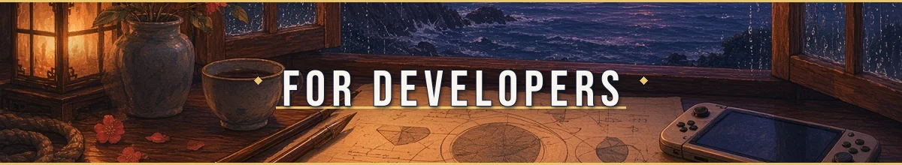
</p>

The port compiles the [pret/pokeheartgold](https://github.com/pret/pokeheartgold) decompilation through [pspoke](https://github.com/IbrahimIrfan/pspoke), retargeted to devkitARM. Platform code lives in `soulsilver3ds/`. Guides live in [`docs/`](docs/).

<details>
<summary><strong>Layout, patches, and doc index</strong></summary>

The native platform layer in `soulsilver3ds/` handles 3DS rendering, audio, input, and settings. Game-side changes are maintained as numbered patches in `pspoke-patches/`. HeartGold is a filtered build of that same source (`scripts/hg_rename.py`, `heartgold3ds/full`); the generated HeartGold copies are not committed.

A stopped build can leave a half-applied patch. `scripts/bootstrap.sh` aborts that leftover before the next patch. The Battle Frontier patch applies on a fresh checkout and on an existing tree.

Conduct, contributing, and security live in [`.github/`](.github/).

- [Architecture](docs/ARCHITECTURE.md) and [development guide](docs/DEVELOPMENT.md)
- [Build guide](docs/BUILDING.md), [setup](docs/SETUP.md), and [FAQ](docs/FAQ.md)
- [Contributing](.github/CONTRIBUTING.md), [project conventions](AGENTS.md), and [handoff notes](HANDOFF.md)
- [Release notes](docs/RELEASE_NOTES.md), [changelog](docs/CHANGELOG.md), and [security policy](.github/SECURITY.md)

</details>

## Credits

<p align="center">
  
</p>

- [unowncollectables](https://github.com/unowncollectables) leads the project and tests on hardware.
- [pret/pokeheartgold](https://github.com/pret/pokeheartgold), [pret/pokeplatinum](https://github.com/pret/pokeplatinum), and [IbrahimIrfan/pspoke](https://github.com/IbrahimIrfan/pspoke) provide the decompilation and native build foundations.
- [3ds-platinum](https://github.com/unowncollectables/3ds-platinum) and [GabeSud0/pokeplatinum-3ds](https://github.com/GabeSud0/pokeplatinum-3ds) contributed platform code, patches, and interface work.
- [Jules (estyseesghosts)](https://github.com/estyseesghosts) created [LOTUS / CITnLO](https://github.com/estyseesghosts/lotus) and [SAV4HGSS-cli](https://github.com/estyseesghosts/SAV4HGSS-cli). Her tools made this showcase possible: direct control and clean captures of both screens, plus reproducible warp and story scenes on disposable save copies.
- [devkitPro](https://devkitpro.org/), libctru, citro3d, and [Azahar](https://azahar-emu.org/) provide tooling for development and testing. Claude, Grok Bot, and Codex contributed code, tooling, and documentation.
- New3DS FBI is this project's installer fork of [FBI by Steveice10](https://github.com/Steveice10/FBI).
- Thanks to everyone who tests builds and shares logs. See [third-party notices](docs/THIRD_PARTY.md) for full attributions.

## Legal

This unofficial, personal-use fan project is licensed under the [GNU GPL v3](LICENSE). You supply the original game data by dumping your own US cartridge (SoulSilver, or HeartGold for that build). The repository contains source code and documentation, including screenshots for illustration. Game assets and trademarks belong to their respective owners. Nintendo, Game Freak, and The Pokémon Company have no affiliation with this project.
