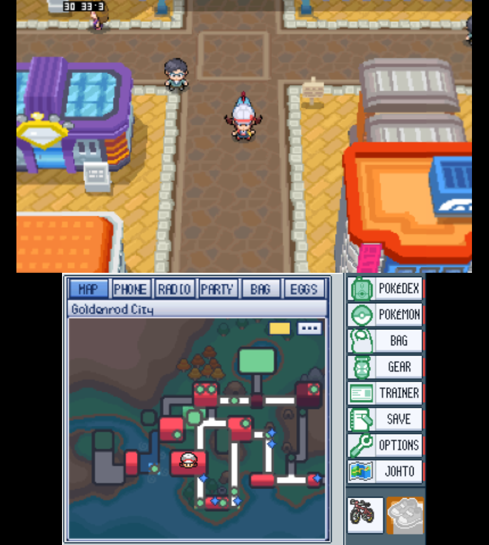
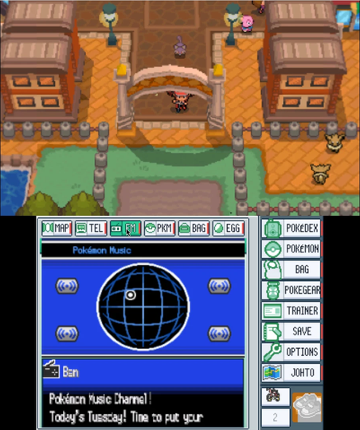

<p align="center">
  
</p>

<h1 align="center">Pokémon SoulSilver for New 3DS</h1>

<p align="center">
  Explore Johto in widescreen, slide into stereoscopic 3D, and keep the Pokégear on the touch screen.<br>
  A fan-made native port for New 3DS, New 3DS XL, and New 2DS XL.
</p>

<p align="center">
  <a href="https://github.com/unowncollectables/patch-builder"><strong>Open Pokémon 3DS Builder →</strong></a><br>
  <a href="#getting-started">Setup guide</a> &nbsp;·&nbsp;
  <a href="#see-it-in-play">Gameplay</a> &nbsp;·&nbsp;
  <a href="#wireless--online">Trading &amp; online</a> &nbsp;·&nbsp;
  <a href="#for-developers">Source &amp; docs</a>
</p>

---

## See it in play

<h3>Goldenrod above. Johto below.</h3>

<p align="center">
  <br>
  <sub>Two-screen gameplay captured in Azahar. The capture shows an earlier touch-panel layout.</sub>
</p>

- **Top screen.** Walk through towns and routes in widescreen, with optional stereoscopic depth in the field and in battles on consoles with a 3D slider.
- **Touch screen.** Check your party, bag, map, phone, or radio without leaving the field. Optional tools surface encounter locations, Fly destinations, egg progress, and Bug-Catching Contest stats.
- **Your save.** Bring over a standard 512 KiB cartridge or flashcart save. The port keeps rolling backups and can export a copy from Settings.
- **Your pace.** Customize battle speed, text speed, move effectiveness hints, and visible wild encounters. Shiny hunt stats live in a separate file.

<details>
<summary>See the Pokégear Radio in play</summary>

<p align="center">
  <br>
  <sub>Radio panel captured in Azahar. Tap-to-tune still needs more hardware testing.</sub>
</p>

</details>

---

## Getting started

You'll need a **New Nintendo 3DS, New 3DS XL, or New 2DS XL** with custom firmware and your own **Pokémon SoulSilver (USA)** cartridge dump. See the [3DS Hacks Guide](https://3ds.hacks.guide/) for console setup.

### Build your copy

On **Windows 10/11**, open [Pokémon 3DS Builder](https://github.com/unowncollectables/patch-builder), choose SoulSilver, then point it at your ROM and SD card. The builder can set up WSL and the toolchain, compile the port, and copy it to the card. Its README covers the full process.

<details>
<summary><strong>Build by hand on Linux or WSL</strong></summary>

Install devkitPro's `3ds-dev` toolchain, Python 3 with `ndspy`, Git, make, patch, rsync, and curl. Keep the ROM outside the clone.

```sh
bash scripts/bootstrap.sh
bash scripts/ss3ds_build.sh ~/roms/SoulSilver.nds
cd soulsilver3ds/full && make check && make
make cia  # Optional HOME Menu package
```

See the [build guide](docs/BUILDING.md) and [toolchain setup](docs/SETUP.md).

</details>

### Install and launch

1. Put `soulsilver3ds.3dsx` in `sdmc:/3ds/` for the Homebrew Launcher, or install `soulsilver3ds.cia` with FBI for the HOME Menu.
2. Place your dump at `sdmc:/3ds/soulsilver3ds/soulsilver.nds`.
3. Launch the game. If you're bringing over a save, use a copy and keep the original somewhere off the SD card.

<details>
<summary><strong>Save files and SD card layout</strong></summary>

The port uses these files in `sdmc:/3ds/soulsilver3ds/`.

- `soulsilver.nds` is your US cartridge dump.
- `soulsilver.sav` is the 512 KiB save. The game creates it on first launch if needed.
- `soulsilver.sav.bak1` through `soulsilver.sav.bak8` are rolling backups.
- `import.sav` is an optional cart, flashcart, or emulator save to import on next launch.
- `config.txt` holds your settings. `hunt.txt` holds hunt stats separately.
- `log.txt` is the current run log. `log_crash.txt` preserves logs from unclean exits.

</details>

## Settings app

Press **L + R + Y** or hold the top-left corner of the touch screen. Use **L / R** or tap to switch tabs, then use **Left / Right / A** to change a value. Close with **B**, **START**, or **L + R + Y** to apply and save changes. **SELECT** reveals the Debug tab.

<details>
<summary><strong>Display defaults and optional tools</strong></summary>

New configurations use **WIDE** title sides and enable the five GPU shortcuts for command packets, fast bounds, second-screen compose, rotating sprites, and fades. Existing values carry over. The [settings reference](soulsilver3ds/full/README_settings.txt) covers many of the `config.txt` keys.

The Pokédex finder, Breeding tab, Hunt stats, Damage check, Alive wild Pokémon, Contest helper, and Tap to Fly are opt-in. Try experimental options with a copy of your save.

</details>

## Wireless &amp; online

**Local.** Turn on Local wireless in Settings → Play on both consoles and enter the Union Room. Discovery can take a moment. Hardware testing has confirmed trading between two consoles running the port. A DS cartridge can't join this 3DS UDS session, and the other Union Room activities are still unverified.

**Online.** Set Wireless to **ONLINE** for community-server GTS and **Mystery Gift → Get via Nintendo WFC**. Both paths have worked on hardware. GTS and Mystery Gift use separate services, and availability depends on the community hosts. Online mode requires `cheat_*` settings to be off. See the [wireless guide](docs/WIRELESS.md).

## Status

**In active development.** The core game, stereoscopic 3D, save round-trips, and local trading have been exercised on hardware. Steady 30 fps across scenes is still the performance target. Fades, some battles, and first visits to a map can hitch.

<details>
<summary><strong>Experimental features and known issues</strong></summary>

- **Pokéwalker.** Send and return transfers completed on a New 3DS. Repeatability and the latest menu rendering fix still need hardware verification.
- **Touch-screen panel.** The seasonal weather radar and the two registered item shortcuts are awaiting on-device checks.
- **3D and widescreen.** The Poké Ball opening can show a double image with the 3D slider up. Wide FX is expensive, and the wide title presentation still needs a dedicated hardware check.
- **Other checks.** Radio tuning, the roamer tracker, Contest helper, Tap to Fly, Alive wild Pokémon, and achievements still need more device coverage.

See the [handoff notes](HANDOFF.md) for test results, the [changelog](CHANGELOG.md) for recent changes, and the [roadmap](docs/ROADMAP.md) for what's planned.

</details>

When [reporting an issue](https://github.com/unowncollectables/Pokemon-Soulsilver-New3ds/issues), include your console model and `log.txt` or `log_crash.txt` from `sdmc:/3ds/soulsilver3ds/`.

## For developers

The port compiles the [pret/pokeheartgold](https://github.com/pret/pokeheartgold) decompilation through [pspoke](https://github.com/IbrahimIrfan/pspoke), retargeted to devkitARM. The native platform layer in `soulsilver3ds/` handles 3DS rendering, audio, input, and settings. Game-side changes are maintained as numbered patches in `pspoke-patches/`.

- [Architecture](docs/ARCHITECTURE.md) and [development guide](docs/DEVELOPMENT.md)
- [Build guide](docs/BUILDING.md), [setup](docs/SETUP.md), and [FAQ](docs/FAQ.md)
- [Contributing](CONTRIBUTING.md), [project conventions](AGENTS.md), and [handoff notes](HANDOFF.md)
- [Release notes](RELEASE_NOTES.md), [changelog](CHANGELOG.md), and [security policy](SECURITY.md)

## Credits

- [unowncollectables](https://github.com/unowncollectables) leads the project and tests on hardware.
- [pret/pokeheartgold](https://github.com/pret/pokeheartgold), [pret/pokeplatinum](https://github.com/pret/pokeplatinum), and [IbrahimIrfan/pspoke](https://github.com/IbrahimIrfan/pspoke) provide the decompilation and native build foundations.
- [3ds-platinum](https://github.com/unowncollectables/3ds-platinum) and [GabeSud0/pokeplatinum-3ds](https://github.com/GabeSud0/pokeplatinum-3ds) contributed platform code, patches, and interface work.
- [devkitPro](https://devkitpro.org/), libctru, citro3d, and [Azahar](https://azahar-emu.org/) provide tooling for development and testing. Claude and Grok Bot contributed code, tooling, and documentation.
- Thanks to everyone who tests builds and shares logs. See [third-party notices](THIRD_PARTY.md) for full attributions.

## Legal

This unofficial, personal-use fan project is licensed under the [GNU GPL v3](LICENSE). You supply the original game data by dumping your own US SoulSilver cartridge. The repository contains source code and documentation, including screenshots for illustration. Game assets and trademarks belong to their respective owners. Nintendo, Game Freak, and The Pokémon Company have no affiliation with this project.
