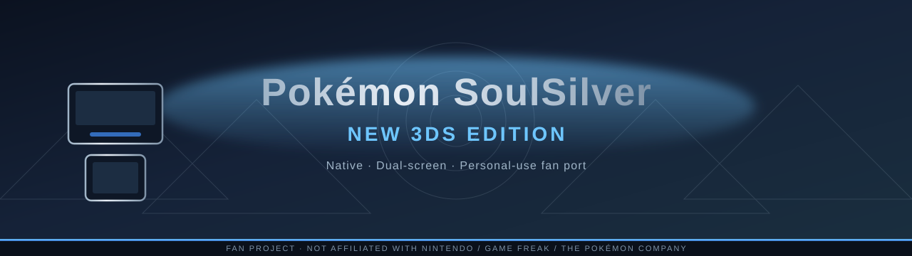

<p align="center">
  
</p>

<p align="center">
  <strong>Back to Johto — natively on the New 3DS.</strong><br/>
  A personal-use, fan-made native port of Pokémon SoulSilver.<br/>
  Sister of the <a href="https://github.com/unowncollectables/3ds-platinum">Platinum 3DS</a> port · built from <em>your</em> legally dumped ROM.
</p>

<p align="center">
  
  
  
  <a href="LICENSE"></a>
</p>

<p align="center">
  <a href="https://github.com/unowncollectables/patch-builder"></a>
  <a href="https://github.com/unowncollectables/Pokemon-Soulsilver-New3ds/commits/main"></a>
  <a href="https://github.com/unowncollectables/Pokemon-Soulsilver-New3ds/issues"></a>
  
</p>

<p align="center">
  <a href="#features">Features</a> ·
  <a href="#status">Status</a> ·
  <a href="#getting-started">Getting started</a> ·
  <a href="#settings-app">Settings</a> ·
  <a href="#wireless--online">Wireless</a> ·
  <a href="#for-developers">Developers</a> ·
  <a href="#credits">Credits</a> ·
  <a href="#legal">Legal</a>
</p>

---

## What this is

**Pokémon SoulSilver New 3DS Edition** compiles the [pret/pokeheartgold](https://github.com/pret/pokeheartgold) decompilation for the New 3DS CPU. It is **not an emulator**: the game’s own C runs natively, drawn the way a 3DS title draws, with both screens filled and optional stereoscopic 3D.

It builds on [pspoke](https://github.com/IbrahimIrfan/pspoke) (retargeted from PSP → 3DS with devkitARM) and reuses the platform layer, patches, and lessons from the Platinum 3DS ports ([3ds-platinum](https://github.com/unowncollectables/3ds-platinum), [GabeSud0/pokeplatinum-3ds](https://github.com/GabeSud0/pokeplatinum-3ds)).

> [!IMPORTANT]
> **No game content ships in this repository.** No ROM, save, graphics, music, text, `.3dsx`, or `.cia` is included or distributed. You supply your own legal **US SoulSilver** cartridge dump; the game reads its data from it at runtime. Dump your own cart. Never commit a ROM or a save.

---

## Features

| | What you get |
| :--- | :--- |
| **Native, not emulated** | Decompiled game code compiled for the 3DS. Real 512 KiB `.sav` files, compatible with carts / flashcarts / PKHeX. |
| **Both screens used** | DS picture scaled ~1.25× onto the 3DS screens, with an optional **wide view** that stretches battles, menus, party, Pokédex and PC across the full 400 px top screen. |
| **Stereoscopic 3D** | Depth from the 3D slider in the overworld, battles, and title. **SHARP 3D** / **FAST 3D** options for crisp mono or supersampled edges (see Settings). |
| **Johto map on the touch screen** | Bottom screen becomes the Johto map + icon column (Pokédex, Pokémon, Bag, Pokégear, Trainer, Save, Options). Steps aside for the game’s own touch UI (YES/NO, starter Poké Balls, Pokégear). **X** opens a highlight cursor over the tiles. |
| **Running Shoes button** | A dedicated **RUN** square on the bottom-screen column toggles running shoes (Sprint Button art read from *your* ROM once the shoes are unlocked). ZL run-toggle and Auto run are also available. |
| **Pokégear on the bottom screen** | MAP / PHONE / RADIO tabs: real Pokégear map, registered contacts (tap to place a call), radio stations, place + time header. |
| **In-game Settings app** | Press **L+R+Y** (or hold the top-left of the touch screen) for Display, Wide, 3D, Input, Battle, Setup, and Play tabs — toggles apply on close and persist in `config.txt`. |
| **Battle QoL** | Optional SUPER EFFECTIVE / NOT VERY / NO EFFECT badges on move buttons; faster battles; catch info; encounter counter; shiny-hunt suite (opt-in). |
| **Local wireless trading** | Full Pokémon trade between two New 3DS consoles via the game’s Union Room over 3DS UDS — confirmed on hardware. |
| **Visible wild Pokémon** | Optional: wilds from the map’s encounter tables walk the field; walk into one to battle. |
| **GPU rendering** | 3D scenes and 2D compositing on the 3DS GPU. |
| **Safe saves & durable logs** | Rolling `.sav` backups; each save is **fsync’d** to the SD card. `log.txt` is fsync’d in batches (and on HOME / sleep / crash) so the last lines **survive reboots and forced closes**; unclean exits are kept as `log_crash.txt`. |
| **HOME Menu ready** | `.cia` with a 3D banner, or `.3dsx` from the Homebrew Launcher. |

---

## Status

| ✅ Confirmed on hardware | 🧪 Built / wired, still baking | 🛠️ Later / wishlist |
| :--- | :--- | :--- |
| Boot, title, overworld, battles, menus, saving; online **GTS** (Global Terminal) | Pokégear RADIO tap-to-tune (needs Radio Card) | Solid path to 60 fps (30 fps is the goal now) |
| 3D depth, wide view, GPU 3D + 2D compose, FAST / SHARP 3D | Roamer + breeding tracker | Wi-Fi Club / Plaza with a real DS |
| Johto map, X tile cursor, YES/NO & starter balls on touch | Union Room Battle, Records, Draw, Greet, Spin | Pokédex encounter locations / times |
| Pokégear MAP / PHONE (calls) / header; battle move badges | | Pokéathlon & Bug-Catching helpers |
| Retail `.sav` round-trip; automatic backups; durable `log.txt`; online **Mystery Gift** (WFC download) | | Tap-to-Fly on the Johto map |
| HMs without the Pokémon, shortcuts, visible wilds, shiny suite | PARTY / BAG read-only bottom tabs | |
| **Local wireless trade between two 3DS consoles** | Speed tweaks / FAST AUTO 3D | |

Details: [`docs/ROADMAP.md`](docs/ROADMAP.md) · history: [`CHANGELOG.md`](CHANGELOG.md) · live notes: [`HANDOFF.md`](HANDOFF.md).

---

## Wireless & online

**Local (3DS ↔ 3DS).** Settings → Play → **Local wireless** maps the game’s DS wireless code onto 3DS UDS. On a hardware run, two New 3DS consoles found each other in the Union Room and completed a full trade (animation included; both Pokémon arrived intact).

- Needs two consoles running this port with Local wireless ON. Discovery can take a moment.
- Untested: Union Room Battle / Records / Draw / Greet / Spin.
- A real DS cannot join locally — native 3DS mode cannot speak DS MP radio.

**Online.** An ONLINE wireless mode drives the game’s own NitroDWC / NitroWiFi stack over 3DS sockets toward community revival servers (Wiimmfi / Poké Classic Network). On hardware, **GTS / Global Terminal** and **Mystery Gift** (Receive → Get via Nintendo WFC) both work. Local wireless Mystery Gift parent search still cannot find a DS parent. Online mode is refused while any `cheat_*` option is on. Back up saves before linking. See [`docs/WIRELESS.md`](docs/WIRELESS.md).

---

## Getting started

### What you need

- A **New Nintendo 3DS / New 3DS XL / New 2DS XL** with custom firmware (Luma3DS) and the Homebrew Launcher (plus **FBI** for the HOME Menu `.cia`). Guide: <https://3ds.hacks.guide>
- Your own dump of **Pokémon SoulSilver (USA)** as `SoulSilver.nds` (dump the cart you own)
- A Windows, Linux, or **WSL Ubuntu** machine to build

### 1. Easiest — Pokemon 3DS Builder

Use the one-window [patch-builder / Pokemon 3DS Builder](https://github.com/unowncollectables/patch-builder): tick SoulSilver (and/or Platinum), point it at the ROM you dumped and your SD card, press **Build and install**. It pulls this project, installs toolchain pieces, compiles, and copies the `.3dsx` (and optionally `.cia`) while backing up your save first. Follow that repo’s README for the click-path.

### 2. Or build by hand (Linux / WSL Ubuntu)

Generic flow from the repo docs — keep the ROM **outside** the clone:

```sh
bash scripts/bootstrap.sh                          # pspoke @ upstream.lock + pspoke-patches/
bash scripts/ss3ds_build.sh ~/roms/SoulSilver.nds  # ROM is read in place, never copied in
cd soulsilver3ds/full && make check && make        # → soulsilver3ds.3dsx
make cia                                           # optional HOME Menu .cia
```

Needs: devkitPro `3ds-dev` (`DEVKITPRO=/opt/devkitpro`), Python 3 + `ndspy`, git, make, patch, rsync, curl, ~3 GB disk. Full detail: [`docs/BUILDING.md`](docs/BUILDING.md) · [`docs/SETUP.md`](docs/SETUP.md).

### 3. Copy to the SD card and play

1. Copy `soulsilver3ds.3dsx` → `sdmc:/3ds/` (Homebrew Launcher) **or** install `soulsilver3ds.cia` with FBI.
2. Place your ROM at `sdmc:/3ds/soulsilver3ds/soulsilver.nds`.
3. Launch. The game creates `soulsilver.sav` beside it if none exists.

<details>
<summary><strong>SD card layout</strong> (<code>sdmc:/3ds/soulsilver3ds/</code>)</summary>

| File | Purpose |
|---|---|
| `soulsilver.nds` | your ROM (required) |
| `soulsilver.sav` | 512 KiB raw save |
| `soulsilver.sav.bak1..8` | automatic copies at launch, after each in-game save, and at clean exit |
| `import.sav` | optional cart / R4 / DeSmuME save to import on next launch |
| `config.txt` | settings written by the in-game Settings app |
| `log.txt` / `log_crash.txt` | run log (fsync’d so tails survive reboots); unclean exits preserved |
| `hunt.txt` | encounter / shiny-hunt counters (never touches the save) |

</details>

**Saves.** Plain 512 KiB `.sav`, interchangeable with a real cart. **Back up off the SD card before every new build.** Rolling backups help; a copy you made yourself is safer.

---

## Settings app

Press **L+R+Y** (or hold the top-left of the touch screen ~0.3 s). L/R or tap switches tab; left/right/A changes a value; B / START / L+R+Y closes. Changes apply on close → `config.txt`. SELECT reveals a hidden Debug tab.

| Tab | Highlights |
|---|---|
| **Display** | Screen scale, Wide view, Camera zoom, Bottom menu HD |
| **Wide** | Wide battles / party / Pokédex / PC / menus, Wide FX (slow — keep off), haze, weather strips, edge fill |
| **3D** | 3D strength, battle depth, Split top, Smooth title 3D, SHARP / FAST 3D modes |
| **Input** | Bottom menu, Pokégear tabs, Auto run, Bottom layout (Johto map or 4×2 tiles), Kanto gate, Menu button, Circle Pad / C-Stick as D-pad, ZR = Y, **ZL run toggle**, IV/EV on summary (Y) |
| **Battle** | Faster battles, Catch info, Encounter counter, SELECT = soft reset, Skip intro on reset |
| **Setup** | Volume, Menu music, Save backups, Export save, Log size / detail, Fast text, Hold B skips text, Auto-advance, FPS counter |
| **Play** | Reusable TMs, Field moves w/o HM, Repel prompt, No wild battles, Visible wild Pokémon, Pokémon menu X/Y shortcuts, Roamer + breeding tracker, **Local / Online wireless** |
| **Debug** (SELECT) | GPU compose / 3D direct, audio limiter / stall fade, Speed tweaks — testing only |

`soulsilver3ds/full/README_settings.txt` lists every `config.txt` key. Experimental toggles: try them on a **copy** of your save. Hidden `cheat_*` keys exist only in `config.txt`, default off, and are not shown in the menu (online mode refuses them).

---

## Known issues

- Poké Ball opening can double-image with the 3D slider up.
- Wide FX costs ~29 ms/frame — leave it off.
- Steady ~30 fps (the game’s own rate); 60 fps is a later experiment ([`docs/FPS60.md`](docs/FPS60.md)).
- Local wireless: trading works; discovery can be slow; other Union Room modes untested.
- First visit to a map can hitch while data loads from the SD card.
- Local wireless Mystery Gift (friend / distribution) still searches forever without a real DS parent; use **Get via Nintendo WFC** with Wireless = ONLINE instead.

Found a bug? Open an [issue](https://github.com/unowncollectables/Pokemon-Soulsilver-New3ds/issues) and attach `sdmc:/3ds/soulsilver3ds/log.txt` (or `log_crash.txt`) plus your console model.

---

## For developers

```
your SoulSilver.nds  (runtime only — never committed)

pret/pokeheartgold → pspoke @ upstream.lock → + pspoke-patches/ → + soulsilver3ds/ platform → .3dsx / .cia
```

- Game C is compiled with GCC for the 3DS. Changes to pspoke live as **numbered patches** in `pspoke-patches/` — never edit an applied patch in place; add a new number.
- `soulsilver3ds/` is the platform layer: GPU renderer / compose, audio, input, Settings app, bottom menu, logging.
- Experimental features get a Settings toggle, removed once proven.

Start here: [`AGENTS.md`](AGENTS.md) · [`docs/HANDOFF.md`](docs/HANDOFF.md) · [`CONTRIBUTING.md`](CONTRIBUTING.md)

<details>
<summary><strong>Doc map</strong></summary>

| Doc | Covers |
| :--- | :--- |
| [`docs/ARCHITECTURE.md`](docs/ARCHITECTURE.md) | how the port is put together |
| [`docs/BUILDING.md`](docs/BUILDING.md), [`docs/SETUP.md`](docs/SETUP.md) | toolchain & build |
| [`docs/DEVELOPMENT.md`](docs/DEVELOPMENT.md) | working on the code |
| [`docs/ROADMAP.md`](docs/ROADMAP.md), [`docs/FAQ.md`](docs/FAQ.md) | plans & common questions |
| [`docs/FPS60.md`](docs/FPS60.md), [`docs/SPEEDUPS.md`](docs/SPEEDUPS.md) | frame-rate work |
| [`docs/WIRELESS.md`](docs/WIRELESS.md) | local UDS + online plan |
| [`docs/PLATINUM_SYNC.md`](docs/PLATINUM_SYNC.md) | shared work with Platinum |
| [`RELEASE_NOTES.md`](RELEASE_NOTES.md), [`CHANGELOG.md`](CHANGELOG.md), [`SECURITY.md`](SECURITY.md), [`THIRD_PARTY.md`](THIRD_PARTY.md) | releases, history, security, licences |

</details>

---

## Credits

- [@unowncollectables](https://github.com/unowncollectables) — project lead, hardware testing, direction
- **[pret/pokeheartgold](https://github.com/pret/pokeheartgold)** (and [pret/pokeplatinum](https://github.com/pret/pokeplatinum)) — the decompilations this port stands on
- **[IbrahimIrfan/pspoke](https://github.com/IbrahimIrfan/pspoke)** (GPL-3.0) — native SoulSilver build retargeted here
- **[GabeSud0](https://github.com/GabeSud0)** / [pokeplatinum-3ds](https://github.com/GabeSud0/pokeplatinum-3ds) — Platinum 3DS port; icons, lower-menu frame drawing, and platform ideas reused (see [`THIRD_PARTY.md`](THIRD_PARTY.md))
- GPL / third-party code credited per file headers and [`THIRD_PARTY.md`](THIRD_PARTY.md) (pspoke, melonDS-derived 2D/3D cores, GabeSud0 pieces, and more)
- **Claude** (Anthropic) — AI pair programmer; much of the platform code, patches, tooling, and docs
- **Grok Bot** — AI contributor; patches, crash fixes, Mystery Gift seeding, README & tooling help
- [devkitPro](https://devkitpro.org), libctru, citro3d; [Azahar](https://azahar-emu.org) for emulator testing
- Everyone who tests, files issues, and shares `log.txt` — thank you. Want a name here? Open a PR.

---

## Legal

This project is licensed under **GPL-3.0** — see [`LICENSE`](LICENSE). pspoke and the pret decompilations carry their own licences.

**No ROMs, assets, saves, or builds are included or distributed.** You must dump your own cartridge. Game data and assets belong to their copyright holders and are read only from the dump you provide.

Pokémon is a trademark of Nintendo / Game Freak / The Pokémon Company. This is an unofficial, personal-use fan project and is **not affiliated with, endorsed by, or connected to** Nintendo, Game Freak, or The Pokémon Company.
