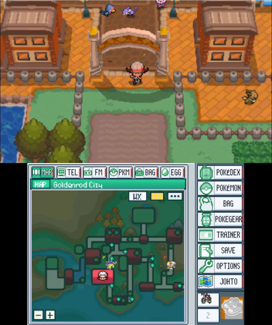
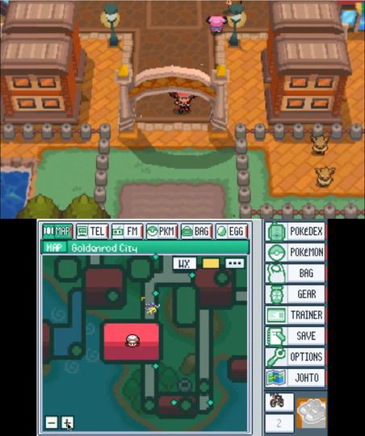
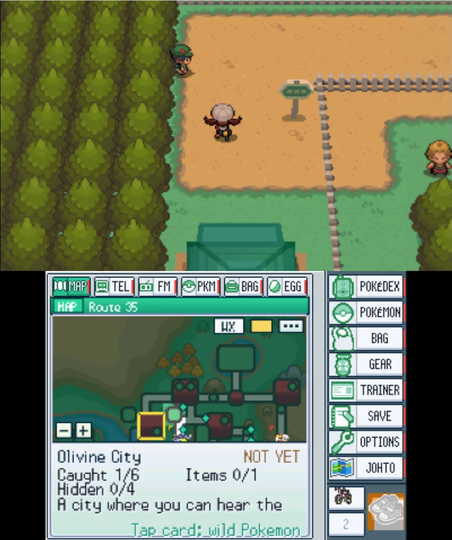
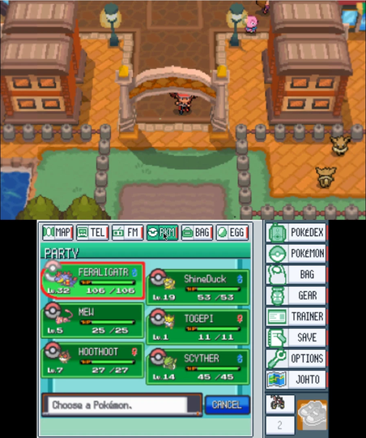
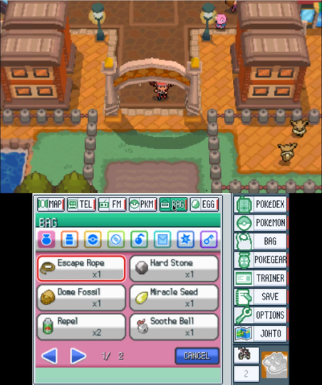
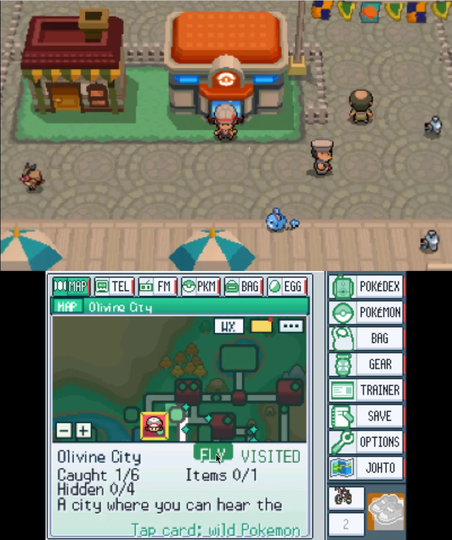
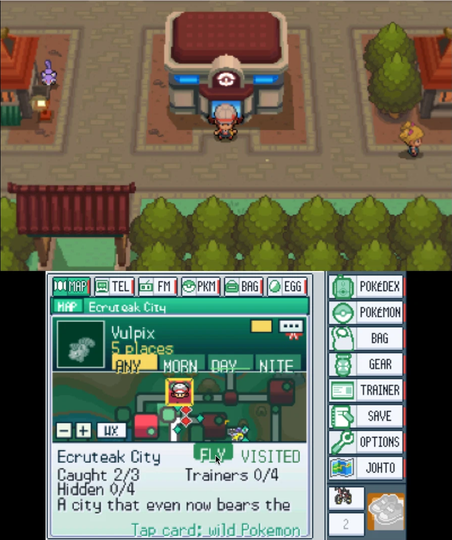
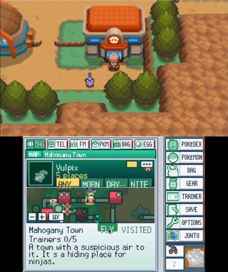
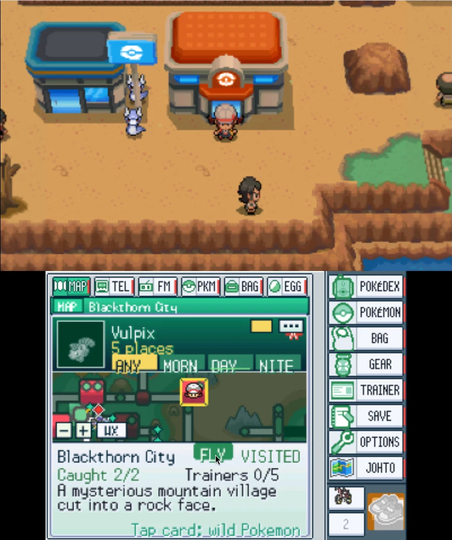

<p align="center">
  
</p>

<h1 align="center">Return to Johto</h1>

<p align="center">
  Explore Johto in widescreen, slide into stereoscopic 3D, and keep the Pokégear on the touch screen.<br>
  A fan-made native port of Pokémon SoulSilver for New 3DS, New 3DS XL, and New 2DS XL.
</p>

<p align="center">
  <a href="#getting-started"></a>
  &nbsp;
  <a href="LICENSE"></a>
  &nbsp;
  <a href="#status"></a>
  &nbsp;
  <a href="#see-it-in-play"></a>
</p>

<p align="center">
  <a href="#see-it-in-play">Gameplay</a>
  &nbsp;·&nbsp;
  <a href="#whats-new">What's new</a>
  &nbsp;·&nbsp;
  <a href="#getting-started">Setup guide</a>
  &nbsp;·&nbsp;
  <a href="#wireless--online">Trading &amp; online</a>
  &nbsp;·&nbsp;
  <a href="#status">Project status</a>
  &nbsp;·&nbsp;
  <a href="#heartgold-experimental">HeartGold</a>
  &nbsp;·&nbsp;
  <a href="#for-developers">Source &amp; docs</a>
</p>

<p align="center">
  <a href="https://github.com/unowncollectables/patch-builder"><strong>Open Pokémon 3DS Builder →</strong></a>
</p>

---

## What's new

> [!NOTE]
> A few recent items from the [changelog](CHANGELOG.md), [handoff](HANDOFF.md), and [release notes](RELEASE_NOTES.md). A 3DS result is listed only where those notes record one.

| Topic | In the tree | On a 3DS |
| --- | --- | --- |
| Bottom map | Settings > Input. Map zoom defaults to 1X; 2X is a closer view, and `-` / `+` on the map do the same. Roamer sprites default on, so the ROM menu icon is used unless a saved line turns it off. The player head now uses the screen pixel of the map pixel it marks, and no longer slips while the view moves. | Not yet. Needs a platform rebuild. |
| Wild Pokémon | Visible wild Pokémon use the map height at their own position, so stairs and slopes stay under that sprite. Hop, shadow, and flyer altitude stay on top of that height. | Not yet. Needs a game rebuild, then a hardware look. |
| Seasons and radar | With Ambient Weather on, eligible clear outdoor maps can show seasonal scenery, and the Johto WX radar labels clear areas separately from a forecast that has not arrived. | Device checks are still pending. |
| Rendering | When `config.txt` has no line for them, the five shortcuts start on (command packets, fast bounds, second-screen compose, rotating sprites, and fades) and the title layout starts at WIDE. A value already in the file is kept. | Run 702 used those five in the field and in battles, including stereo. That pass does not cover every scene. The wide title screen is still unconfirmed on a 3DS. |

## See it in play

### Goldenrod above. Johto below.

<table>
  <tr>
    <td align="center">
      <br>
      <sub>Goldenrod with visible wild Pokémon and roamer sprites on the map.</sub>
    </td>
    <td align="center">
      <br>
      <sub>Bottom map at 2X zoom.</sub>
    </td>
    <td align="center">
      <br>
      <sub>Route 35, just north of Goldenrod.</sub>
    </td>
  </tr>
  <tr>
    <td align="center">
      <br>
      <sub>Party panel without leaving the field.</sub>
    </td>
    <td align="center">
      <br>
      <sub>Bag panel.</sub>
    </td>
    <td align="center">
      <br>
      <sub>Radio panel. Tap-to-tune still needs more hardware testing.</sub>
    </td>
  </tr>
</table>

### Around Johto

<table>
  <tr>
    <td align="center">
      <br>
      <sub>Olivine City.</sub>
    </td>
    <td align="center">
      <br>
      <sub>Ecruteak City.</sub>
    </td>
  </tr>
  <tr>
    <td align="center">
      <br>
      <sub>Mahogany Town.</sub>
    </td>
    <td align="center">
      <br>
      <sub>Blackthorn City, with Tap to Fly on the bottom map.</sub>
    </td>
  </tr>
</table>

<sub>All screenshots captured in the Azahar emulator from a personal build.</sub>

- **Top screen.** Walk through towns and routes in widescreen, with optional stereoscopic depth in the field and in battles on consoles with a 3D slider.
- **Touch screen.** Check your party, bag, map, phone, or radio without leaving the field. Optional tools surface encounter locations, Fly destinations, egg progress, and Bug-Catching Contest stats.
- **Your save.** Bring over a standard 512 KiB cartridge or flashcart save. The port keeps rolling backups and can export a copy from Settings.
- **Your pace.** Customize battle speed, text speed, move effectiveness hints, and visible wild encounters. Shiny hunt stats live in a separate file.

<p align="center">
  
</p>

## Getting started

### 01 · Check your kit

- **Console** — New Nintendo 3DS, New 3DS XL, or New 2DS XL with custom firmware. See the [3DS Hacks Guide](https://3ds.hacks.guide/) for console setup.
- **Game** — Your own dump of Pokémon SoulSilver (USA).
- **SD card** — The card you use with the console. If you already play this port, copy your save off the card before replacing the build.

### 02 · Build your copy

On **Windows 10/11**, open [Pokémon 3DS Builder](https://github.com/unowncollectables/patch-builder), choose **SoulSilver**, and select your ROM and SD card. The builder sets up the toolchain and can install the finished build directly to the card.

<details>
<summary><strong>Build by hand on Linux or WSL</strong></summary>

Install devkitPro's `3ds-dev` toolchain, Python 3 with `ndspy`, Git, make, patch, rsync, and curl. Keep the ROM outside the clone.

```sh
bash scripts/bootstrap.sh
bash scripts/ss3ds_build.sh ~/roms/SoulSilver.nds
cd soulsilver3ds/full && make check && make
make cia  # Optional HOME Menu package
```

See the [build guide](docs/BUILDING.md) and [toolchain setup](docs/SETUP.md).

</details>

### 03 · Launch from your console

If you're copying the files yourself, choose one of these launch options and put your dump at `sdmc:/3ds/soulsilver3ds/soulsilver.nds`.

- **Homebrew Launcher** — Copy `soulsilver3ds.3dsx` into `sdmc:/3ds/`.
- **HOME Menu** — Install `soulsilver3ds.cia` using FBI.

When bringing over an existing save, use a copy and keep the original off the SD card.

<details>
<summary><strong>Save files and SD card layout</strong></summary>

The port uses these files in `sdmc:/3ds/soulsilver3ds/`.

- `soulsilver.nds` is your US cartridge dump.
- `soulsilver.sav` is the 512 KiB save. The game creates it on first launch if needed.
- `soulsilver.sav.bak1` through `soulsilver.sav.bak8` are rolling backups.
- `import.sav` is an optional cart, flashcart, or emulator save to import on next launch.
- `config.txt` holds your settings. `hunt.txt` holds hunt stats separately.
- `log.txt` is the current run log. `log_crash.txt` preserves logs from unclean exits.

</details>

## Settings app

> **Open Settings with `L + R + Y`** or hold the top-left corner of the touch screen.

- **Browse** with `L` and `R` or tap a tab. Press `SELECT` to reveal Debug.
- **Change a setting** with `←`, `→`, or `A`.
- **Apply and save** by closing with `B`, `START`, or `L + R + Y`.

<details>
<summary><strong>Display defaults and optional tools</strong></summary>

New configurations use **WIDE** title sides and enable the five GPU shortcuts for command packets, fast bounds, second-screen compose, rotating sprites, and fades. Existing values carry over. The [settings reference](soulsilver3ds/full/README_settings.txt) covers many of the `config.txt` keys.

When `config.txt` has no line for them, these start on: Pokédex finder, Breeding tab, Hunt stats, Damage check, Alive wild Pokémon (ON + TOWNS), Contest helper, Tap to Fly, Roamer sprites, Ambient weather, Reusable TMs, Event Pokémon without the event flag, Sharp 3D at FAST AUTO, and Pokéwalker. A value already in the file is kept. Try a copy of your save before relying on an experimental option.

</details>

## Wireless &amp; online

**Local.** Turn on Local wireless in Settings → Play on both consoles and enter the Union Room. Discovery can take a moment. Hardware testing has confirmed trading between two consoles running the port. A DS cartridge can't join this 3DS UDS session, and the other Union Room activities are still unverified.

**Online.** Set Wireless to **ONLINE** for community-server GTS and **Mystery Gift → Get via Nintendo WFC**. Both paths have worked on hardware. GTS and Mystery Gift use separate services, and availability depends on the community hosts. Online mode requires `cheat_*` settings to be off. See the [wireless guide](docs/WIRELESS.md).

## Status

**In active development.** The core game, stereoscopic 3D, save round-trips, and local trading have been exercised on hardware. Steady 30 fps across scenes is still the performance target. Fades, some battles, and first visits to a map can hitch.

<details>
<summary><strong>Experimental features and known issues</strong></summary>

- **Pokéwalker.** Send and return transfers completed on a New 3DS. Repeatability and the latest menu rendering fix still need hardware verification.
- **Touch-screen panel.** The seasonal weather radar and the two registered item shortcuts are awaiting on-device checks.
- **3D and widescreen.** The Poké Ball opening can show a double image with the 3D slider up. Wide FX is expensive, and the wide title presentation still needs a dedicated hardware check.
- **Other checks.** Radio tuning, the roamer tracker, Contest helper, Tap to Fly, Alive wild Pokémon, and achievements still need more device coverage.

See the [handoff notes](HANDOFF.md) for test results, the [changelog](CHANGELOG.md) for recent changes, and the [roadmap](docs/ROADMAP.md) for what's planned.

</details>

When [reporting an issue](https://github.com/unowncollectables/Pokemon-Soulsilver-New3ds/issues), include your console model and `log.txt` or `log_crash.txt` from `sdmc:/3ds/soulsilver3ds/`.

## HeartGold (experimental)

<details>
<summary><strong>SD paths, build commands, and experimental status</strong></summary>

The same port also builds **Pokémon HeartGold** (US) as a completely separate game. It shares every line of the port with SoulSilver, and nothing about it touches a SoulSilver install or save.

| | SoulSilver | HeartGold |
| --- | --- | --- |
| SD folder | `sdmc:/3ds/soulsilver3ds/` | `sdmc:/3ds/heartgold3ds/` |
| Game file and save | `soulsilver.nds`, `soulsilver.sav` | `heartgold.nds`, `heartgold.sav` |
| Programs | `soulsilver3ds.3dsx` / `.cia` | `heartgold3ds.3dsx` / `.cia` |
| HOME Menu title | `000400000F7D4000` | `000400000F7D4100` (installs beside SoulSilver) |

Build it with the [Pokemon 3DS Builder](https://github.com/unowncollectables/patch-builder) (tick **Pokemon HeartGold**), or by hand:

```sh
bash scripts/hg_build.sh /path/to/HeartGold.nds     # compiles the game as HeartGold (long the first time)
make -C heartgold3ds/full                           # heartgold3ds.3dsx
make -C heartgold3ds/full cia                       # heartgold3ds.cia, with Ho-Oh on the HOME Menu banner
```

**Status: experimental.** HeartGold compiles, links, and packages, and the build refuses to link a HeartGold program that still names a SoulSilver file. It has **not been played on a console yet**: every SoulSilver hardware result above still needs its own HeartGold check, online included. Your HeartGold game file is only read, and Ho-Oh for the banner is taken from it at build time; nothing from the game is in this repository.

</details>

## For developers

The port compiles the [pret/pokeheartgold](https://github.com/pret/pokeheartgold) decompilation through [pspoke](https://github.com/IbrahimIrfan/pspoke), retargeted to devkitARM. The native platform layer in `soulsilver3ds/` handles 3DS rendering, audio, input, and settings. Game-side changes are maintained as numbered patches in `pspoke-patches/`.

- [Architecture](docs/ARCHITECTURE.md) and [development guide](docs/DEVELOPMENT.md)
- [Build guide](docs/BUILDING.md), [setup](docs/SETUP.md), and [FAQ](docs/FAQ.md)
- [Contributing](CONTRIBUTING.md), [project conventions](AGENTS.md), and [handoff notes](HANDOFF.md)
- [Release notes](RELEASE_NOTES.md), [changelog](CHANGELOG.md), and [security policy](SECURITY.md)

## Credits

- [unowncollectables](https://github.com/unowncollectables) leads the project and tests on hardware.
- [pret/pokeheartgold](https://github.com/pret/pokeheartgold), [pret/pokeplatinum](https://github.com/pret/pokeplatinum), and [IbrahimIrfan/pspoke](https://github.com/IbrahimIrfan/pspoke) provide the decompilation and native build foundations.
- [3ds-platinum](https://github.com/unowncollectables/3ds-platinum) and [GabeSud0/pokeplatinum-3ds](https://github.com/GabeSud0/pokeplatinum-3ds) contributed platform code, patches, and interface work.
- [devkitPro](https://devkitpro.org/), libctru, citro3d, and [Azahar](https://azahar-emu.org/) provide tooling for development and testing. Claude and Grok Bot contributed code, tooling, and documentation.
- Thanks to everyone who tests builds and shares logs. See [third-party notices](THIRD_PARTY.md) for full attributions.

## Legal

This unofficial, personal-use fan project is licensed under the [GNU GPL v3](LICENSE). You supply the original game data by dumping your own US SoulSilver cartridge. The repository contains source code and documentation, including screenshots for illustration. Game assets and trademarks belong to their respective owners. Nintendo, Game Freak, and The Pokémon Company have no affiliation with this project.
